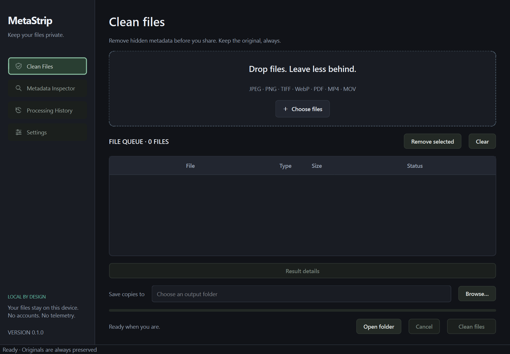

# MetaStrip

MetaStrip is a desktop utility for inspecting metadata and creating cleaned copies of files. It processes files locally and preserves the originals.

**Version 0.1.0** is the first source release candidate. Windows is the primary desktop target.

## Features

- Inspect embedded metadata and review potentially identifying fields.
- Queue files by browsing or dragging them into the window.
- Clean files in the background, cancel work, and review verification results.
- Save verified copies under unique names without overwriting existing files.
- Enable local processing history and choose how long to retain it.

## Supported formats

| Format | Cleaning method | Requirements and limits |
| --- | --- | --- |
| JPEG, PNG, WebP | Remove supported metadata without recompressing image data | Animated images and JPEGs with additional image data are unsupported. |
| TIFF | Remove metadata with ExifTool and check decoded pixels | ExifTool required for cleaning. Single-page TIFF only. |
| PDF | Remove document properties, XMP, and attachments in a full rewrite. Optionally remove annotations. | Encrypted, damaged, signed, form-enabled, and active PDFs are refused. |
| MP4, MOV | Remove container and stream tags using stream copy | FFmpeg and ffprobe required. Subtitle, data, and attachment streams are unsupported for cleaning. |

MetaStrip uses Python, PySide6 (Qt), Pillow, and PyMuPDF. It uses ExifTool for additional image inspection, and FFmpeg and ffprobe for video processing.

## Install and launch on Windows

Use Windows 10 or 11 and Python 3.12 or newer. Open PowerShell in the project root.

```powershell
py -3.12 -m venv .venv
.\.venv\Scripts\python.exe -m pip install -e .
.\.venv\Scripts\python.exe -m app
```

For an existing environment with dependencies installed, run only the last command. If you use a Python version newer than 3.12, select that version with the Windows launcher.

Install [ExifTool](https://exiftool.org/install.html) and [FFmpeg with ffprobe](https://ffmpeg.org/download.html) separately for the features listed above. Put their executables on `PATH` or set `METASTRIP_EXIFTOOL`, `METASTRIP_FFMPEG`, and `METASTRIP_FFPROBE` to their absolute paths. Check **Settings** for tool diagnostics.

## Usage

1. Open **Clean Files** and add one or more files.
2. Choose an output folder and select **Clean files**.
3. Review each result’s verification details before sharing. Use **Metadata Inspector** to inspect a file separately.

The CLI can inspect and clean files from the same environment.

```powershell
.\.venv\Scripts\python.exe -m app.cli inspect .\photo.jpg
.\.venv\Scripts\python.exe -m app.cli clean .\photo.jpg --output .\cleaned
```

## Screenshots



[Metadata Inspector on Windows](assets/screenshots/metadata-inspector.png)

## Tests

```powershell
.\.venv\Scripts\python.exe -m pip install -e ".[dev]"
.\.venv\Scripts\python.exe -m pytest -ra
.\.venv\Scripts\python.exe -m ruff check .
.\.venv\Scripts\python.exe -m ruff format --check app tests scripts
```

Tests use synthetic fixtures. Integrations that require optional tools skip when the tools are unavailable. See [validation](docs/VALIDATION.md) for the test commands and scope.

## Limits and privacy

Verification covers supported structures and configured checks. It cannot guarantee anonymization or secure redaction. Visible document content, audio, and private data inside encoded media may remain. Retaining an ICC profile preserves color information, which can include identifying descriptions.

Processing stays local. History is opt-in and can retain filenames and output paths. See [SECURITY.md](SECURITY.md) for reporting and file-handling details.

## License

MetaStrip is distributed under the [GNU Affero General Public License, version 3
only (AGPL-3.0-only)](LICENSE). The source for each release is available from
its repository tag. Existing MIT notices are preserved in
[LICENSES/MIT.txt](LICENSES/MIT.txt).

PyMuPDF and MuPDF are used under their AGPL terms. Other dependencies and
separately installed tools retain their own licenses. See the
[third-party notices](THIRD_PARTY_NOTICES.md) and
[PDF backend review](docs/PDF_BACKEND.md).
